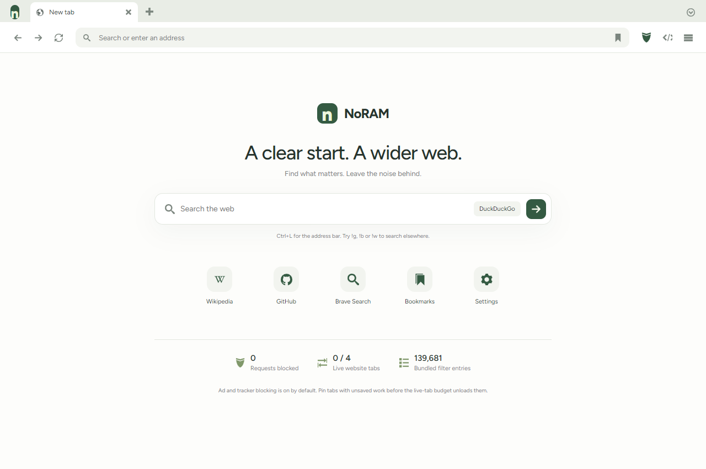

# NoRAM Browser 0.2

A Windows browser with a Rust shell, Chromium/WebView2 rendering, Brave's **adblock-rust** engine, and a deliberately small interface. This is an experimental browser, not a new rendering engine or a full Brave/Chrome/Firefox replacement. No comparative speed, RAM or CPU advantage has been established.



## Build and run

Requirements: Windows 10/11, a current [Evergreen WebView2 Runtime](https://developer.microsoft.com/en-us/microsoft-edge/webview2/), Rust stable (tested with 1.97.0), and Visual Studio C++ Build Tools with the Windows SDK.

```powershell
cargo run --release --locked
```

Or:

```powershell
cargo build --release --locked
.\target\release\noram-browser.exe
.\target\release\noram-browser.exe --private
.\target\release\noram-browser.exe --profile C:\path\to\separate-profile
```

An optional HTTP/HTTPS URL opens on launch. Normal instances use an exclusive profile lock. Private windows do not write NoRAM bookmarks, settings, history or tab sessions. Engine security updates come from Microsoft's Evergreen runtime; NoRAM has no app auto-updater or installer yet.

## What's included

- **Clean, local UI:** rounded filled IcoMoon Free SVG icons, local font assets, light/dark/system themes, optional bookmarks bar. Uses installed Proxima Nova (DuckDuckGo's default family), with bundled Figtree as a licensed fallback. Proxima Nova is not bundled.
- **Search:** DuckDuckGo, Brave Search, Google, Bing, Startpage, Ecosia and Wikipedia. Choose a default or use `!d`, `!b`, `!g`, `!bi`, `!s`, `!e`, `!w` followed by search terms. Search terms are sent to the chosen provider.
- **Tabs:** instant visual selection, stable DOM elements, drag reordering, middle-click close, pin/keep awake, mute/unmute, duplicate, close other/right tabs, reopen the last 20 closed tabs, and a searchable tab manager. Pins and mute state survive session restoration.
- **Bookmarks and history:** search, open, rename/delete bookmarks, delete history entries or clear history. Local history is bounded to 2,000 entries, with the latest 150 displayed. A tab restore reloads URLs; page state is not persisted.
- **Ad and tracker blocking:** native request interception through Brave's adblock-rust 0.13.3, bundled EasyList and EasyPrivacy snapshots, ABP network syntax with request types and exceptions, site exceptions, and domain-specific cosmetic CSS hiding after page load. A verified compiled-filter cache accelerates later launches.
- **Privacy:** strict engine tracking prevention, configurable HTTPS-only policy, tracking-parameter cleanup, DNT and Sec-GPC request signals. Website permissions are denied, including camera, microphone, geolocation, notifications and clipboard reads. Denial can break site features; there is no permission-grant UI yet.
- **Resources:** configurable live-page budget, least-recently-used background unloading, lazy session restoration. The browser has no two-second polling loop; native page events drive updates. Profile writes are coalesced in a background worker.
- **Extensions:** load a local unpacked extension folder containing `manifest.json`, list installed extensions, enable/disable/remove them. Uses the real WebView2 extension APIs. Chrome Web Store installation, full Chromium API compatibility, extension toolbar popups and permission prompts are not included. Manage extensions in normal windows; trust the code you load.
- **VPN connections:** enumerate current-user Windows VPN profiles, connect/disconnect using saved credentials, refresh OS connection status, and open Windows VPN settings. This controls real OS VPN profiles. It is **not a bundled VPN provider**, does not include servers or credentials, and provides no browser-only tunnel or kill switch. With no configured profile there is no VPN connection. No automatic connection is attempted.
- **Tools:** find in page, zoom, print/save PDF, developer tools and native WebView2 downloads UI.

## Resource and privacy limits

“NoRAM” is a name, not a zero-memory claim. WebView2 uses multiple processes. The trusted UI is in a separate engine environment from websites/extensions, with a memory cost for that isolation. Extension management/storage clearing creates a small hidden service view on demand; the displayed live-page count excludes this and the trusted UI.

Unloading destroys the page webview, losing unsaved forms, media playback, scroll position and in-tab back history. Pin forms, calls and active downloads. Pinned tabs can exceed the budget. Active forms, audio and downloads are not automatically detected. Session restore opens a fresh start tab and keeps restored sites unloaded until selected; at most 100 website tabs restore. NoRAM permits up to 128 total tabs. Reopening a closed tab reloads its URL.

The adblock engine is integrated for network matching and domain-specific CSS selectors. It does not provide all of Brave Shields: no scriptlet resource bundle, procedural cosmetic filters, dynamic generic-selector scanning, redirect resources, or comprehensive WebSocket filtering. CSS hiding runs after load in the top document; embedded frames and site CSP may limit it. Bundled lists are snapshots dated 17 October 2026 and do not update automatically. The counter includes application-intercepted requests only; engine tracking prevention can block other requests before interception.

Blocking tracking ads does not guarantee fingerprint resistance. Private browsing does not hide your IP, protect against network observation, erase downloads or guarantee forensic erasure. Private windows can share an InPrivate session while open. Normal bookmarks are available in private windows, but their changes remain in memory. Private history is not recorded. DNT/GPC depend on site support. HTTPS-only behavior and tracking-parameter cleanup may break some sites.

Not included: account sync, password manager, browser import/export UI, reader mode, translation, tab groups, hardened fingerprint randomization, Tor, a bundled VPN network, OS default-browser registration, app auto-updates, or macOS/Linux packaging. DRM and browser-specific authentication flows may fail. This is not an audited hardened browser.

## Shortcuts

| Shortcut | Action |
|---|---|
| Ctrl+L | Address bar |
| Ctrl+T / Ctrl+W | New / close tab |
| Ctrl+Shift+T | Reopen closed tab |
| Ctrl+Tab / Ctrl+Shift+Tab | Next / previous tab |
| Ctrl+Shift+A | Search tabs |
| Ctrl+D | Toggle bookmark |
| Ctrl+Shift+O | Bookmarks |
| Ctrl+H | History |
| Ctrl+F | Find in page |
| Ctrl+R / F5 | Reload |
| Escape | Stop loading |
| Ctrl+P | Print / save PDF |
| Ctrl+Shift+N | Private window |
| F12 | Website developer tools |

## Data and architecture

Normal profile: `%LOCALAPPDATA%\NoRamBrowser`, or the `--profile` directory. `browser.json` holds plaintext preferences, bookmarks, history and session metadata; protect it through OS permissions and disk encryption. `browser.lock` prevents concurrent normal writers. `WebView/` holds website data and extensions; `Interface/` isolates the trusted UI; `filters-*.dat` contains a version/content-keyed, verified adblock cache. Private windows do not write this cache.

`src/main.rs` owns tabs and native events. `src/policy.rs` handles URL/search policies and adblock-rust. `src/platform.rs` handles WebView2 permissions, blocking, extensions and shortcuts. `src/services.rs` handles the profile writer, native folder picker and Windows VPN commands. UI source is `assets/shell.html`, `assets/style.css`, and `assets/app.js`.

Only the trusted fixed-origin UI has an application IPC handler, and incoming IPC origins are checked. Websites and extension-enabled webviews have no native command bridge. Website titles/URLs are rendered through DOM text nodes. The trusted UI has a restrictive CSP, no external scripts/fonts/telemetry, and rejects navigation away from its origin. The runtime sandbox and SmartScreen are preserved. Extensions may read/change website content, but are not injected into the separate trusted-UI environment.

Technical sources: [adblock-rust](https://github.com/brave/adblock-rust), [Wry](https://github.com/tauri-apps/wry), [WebView2 extensions](https://learn.microsoft.com/en-us/microsoft-edge/webview2/concepts/overview-features-apis), [DuckDuckGo font settings](https://duckduckgo.com/duckduckgo-help-pages/settings/params).

## Verification

```powershell
cargo fmt --check
cargo test --locked
cargo clippy --locked --all-targets -- -D warnings
cargo build --release --locked
```

See [verification notes](docs/verification.md) for actual-app results and the local test workflow. For disposable tests, `--background --debug-port 9240` hides the window and opens loopback CDP ports 9240 (trusted UI) and 9241 (websites/extensions). Neither port is requested on normal launches. Do not use remote debugging on a personal profile. The profile writer flushes on normal window close; forced termination can lose the latest coalesced write.

## Licenses

MIT for the application source. Icons, fonts, filter lists and Rust dependencies retain their own licenses. See [third-party notices](THIRD_PARTY_NOTICES.md), including IcoMoon's CC BY attribution, Figtree's OFL, EasyList/EasyPrivacy's CC BY-SA terms and adblock-rust's MPL-2.0.
