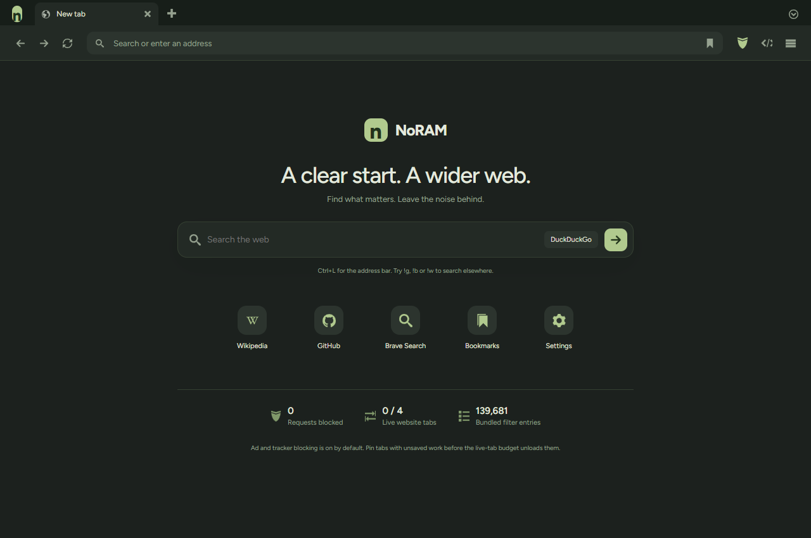

# NoRAM 0.2 verification — 17 October 2026

Tested on Windows with Rust 1.97.0 and the installed Evergreen WebView2 Runtime. The optimized executable was tested in disposable profiles, independently of personal browsing. Screenshots are actual app webviews, not design mockups.




## Build checks

- `cargo fmt --check` passed.
- `cargo test --locked --offline` passed: six tests covering URL cleanup, search selection/bang overrides, unsafe schemes, domain boundaries, and Brave engine request-type/exception matching.
- `cargo clippy --locked --offline --all-targets -- -D warnings` passed with no code diagnostics. The Windows sandbox emitted an incremental-cache hard-link fallback warning; it copied files instead.
- `cargo build --release --locked --offline` passed.
- JavaScript syntax checks passed for the UI and smoke scripts.

Cargo uses one build job to avoid the memory spikes seen with parallel compilation of the generated Windows bindings. No CodeRabbit CLI was installed; review was local, supported by Rust checks and the native tests below.

## Native browser and privacy regression

`scripts/smoke.js` passed all 14 grouped checks against the optimized executable:

- Real website rendering in a content webview.
- Tracking-parameter removal with a functional query parameter preserved.
- A loopback HTTP server actually received `DNT: 1` and `Sec-GPC: 1`.
- Native geolocation permission denial.
- The application interceptor returned HTTP 403 for `ads.noram.test` and incremented the blocked counter. This reserved domain avoids dependence on a real advertiser's network.
- Bookmark creation and native back/forward navigation.
- An unsolicited popup was denied after transient user activation expired; a clicked new-window link opened a tab.
- Live-tab-budget unloading and resumption; pinned tabs were exempt.
- Rejection of `javascript:` addresses, public HTTP-to-HTTPS upgrade, and no UI JavaScript exceptions during the suite.

Real ad domains can be blocked by the engine's strict tracking prevention before the application handler sees them. Those requests are not included in NoRAM's counter. A blocked test URL proves interception, not comprehensive coverage of all advertisements or trackers.

`scripts/private-smoke.js` passed four checks: private-mode flag, private inability to read normal localStorage, normal inability to read private localStorage, and private bookmark functionality in memory. A SHA-256 comparison confirmed `browser.json` did not change during the private actions. Normal history was not extended by private browsing. This is not a forensic-erasure or anonymity test.

`scripts/restore-smoke.js` passed five checks after a restart: zero live website pages on lazy restoration, bookmark restoration, retained pin/mute state, persisted normal localStorage, and native site-data clearing with its completion callback and verified removal of the stored value. The compiled adblock cache was reused without rewriting it. The cache filename depends on the bundled lists and engine version, and deserialization verifies its format before use.

## UI, tabs and added features

`scripts/v02-smoke.js` passed 13 grouped checks:

1. Theme selection and the bookmarks bar.
2. Search-engine preference selection.
3. Bookmark renaming and search filtering.
4. Stable tab DOM across 300 identical state updates.
5. Drag reordering of actual browser tabs.
6. Duplicate, close and reopen actions.
7. Native tab muting.
8. A real unpacked extension's content script ran on a website.
9. That extension used `<all_urls>` and was not injected into the separate trusted UI environment.
10. The extension could be disabled, re-enabled and removed. A fresh website navigation verified its absence while disabled and return while enabled.
11. Windows VPN profile enumeration completed successfully and returned an empty list. The UI displayed that no profiles were configured; it did not pretend to connect.
12. The bundled Figtree font loaded.
13. All 34 visible SVG icon instances had rendered geometry.

With five tabs, every tab DOM node remained the same through 300 repeated updates. The 95th-percentile synchronous UI reconciliation time was approximately **0.2 ms** in this local run. This excludes native IPC, rendering/compositing, sleeping-tab recreation, network requests and website execution. It is not an end-to-end tab-switch latency or a browser performance comparison.

Visual QA verified both light and dark start pages. It caught and repaired dark-theme text contrast and a missing favicon route. The start page had no horizontal overflow at 760- and 1600-pixel CSS viewport widths; the final UI console reported zero errors and warnings. Existing personal browser tabs were not used for these tests.

## Reproduce locally

Run commands from the repository root. Install/use the Playwright CLI separately; it is a developer tool, not a browser dependency. Use fresh disposable profiles; the smoke scripts change test preferences, bookmarks and page storage.

Start the loopback fixture in one terminal:

```powershell
node scripts/qa-server.cjs
```

Build and start a hidden instance in another:

```powershell
cargo build --release --locked
New-Item -ItemType Directory -Force output/playwright | Out-Null
$qaBrowser = Start-Process .\target\release\noram-browser.exe -ArgumentList '--profile artifacts/smoke-profile --background --debug-port 9240' -PassThru
playwright-cli -s=noram-smoke attach --cdp http://127.0.0.1:9240
playwright-cli -s=noram-smoke snapshot
playwright-cli -s=noram-smoke run-code --filename scripts/smoke.js
```

The UI is at port 9240; website/extension webviews are in a separate engine environment at 9241. The scripts connect to that second endpoint after a website environment exists. Use `--debug-port`, rather than a process-wide `WEBVIEW2_ADDITIONAL_BROWSER_ARGUMENTS` override that would assign both environments the same port. Normal app launches request no debugging ports.

For the private test, launch the same executable with `--private --profile artifacts/smoke-profile --background --debug-port 9240`, then run `scripts/private-smoke.js` in the existing attached session. Compare the profile JSON's SHA-256 before and after the private actions. Stop only that private test process when complete.

Run `scripts/v02-smoke.js` after the original smoke suite. It loads only the harmless fixture extension in `tests/extension`, checks it, then removes it. It enumerates VPN profiles without attempting any connection. Before the restore check, mute the pinned fixture tab with URL ending `/two`, allow the background profile write to settle, restart the test instance on the same profile, and run `scripts/restore-smoke.js`.

Close the disposable app processes and the fixture server afterward. Never enable remote debugging for a personal browsing profile. The smoke scripts exercise the real Rust command handlers; navigation, tab dragging, bookmark editing and settings also use actual UI interactions.

## Limits of this evidence

No comparative CPU, memory, startup or page-load benchmark was performed. Count the entire WebView2 process tree when measuring resources, including the separate trusted interface environment and any extension service view. Shared-memory accounting, page set, runtime versions, cache state, viewport and idle period must be controlled.

No VPN tunnel was established because no VPN profile/provider was available. The connect/disconnect implementation invokes Windows against an explicitly selected saved profile; its behavior with a real provider remains unverified. This is not an included VPN service or kill switch.

Chrome Web Store compatibility, extension toolbar popups, every Chromium extension API, advanced cosmetic rules/scriptlets, fingerprint resistance, all website permissions, DRM, downloads/printing, screen-reader accessibility, long-running stability and clean-machine installation were not comprehensively tested. Adblock lists are bundled snapshots, not an automatic update service. Hosted GitHub Actions status must be checked separately from these local results.
